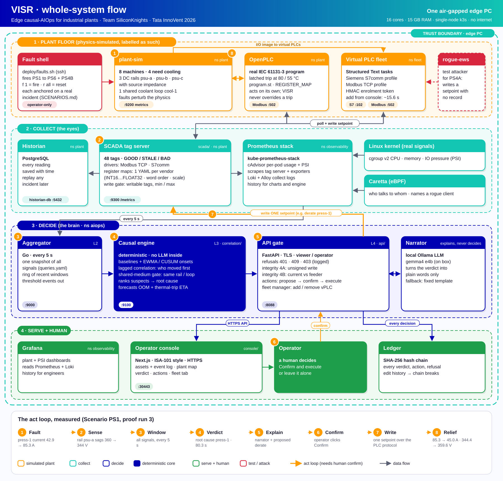

# Tata InnoVent 2026: Team SiliconKnights

**VISR** is an edge causal-AIOps brain for industrial systems (category §3.2.2.5, *Edge AI for
Connected, Secure & Intelligent Industrial Systems*). One engine watches two planes. The first is a
**physics-simulated plant floor**: DC rails with source impedance, a shared coolant loop, and a real
OpenPLC trip interlock. Faults perturb the model, and the symptoms *emerge*. The second plane is
**the edge box itself**, through real kernel pressure signals. The engine detects deviation from
learned baselines and attributes root cause across declared shared media (witness + temporal
evidence, threshold-free). It also forecasts failures (OOM and thermal-trip ETAs) and narrates the
verdict. The simulated substrate is labeled as such everywhere. The inference on top of it is real.

## Architecture

  

## Layout

| Path | What |
|---|---|
| `plant/` · `plc/` · `scada/` | Plant physics sim, OpenPLC trip program, SCADA tag server + historian writer |
| `vplc/` | Virtual PLC runtime: Structured Text tasks, S7comm and Modbus TCP protocol profiles (2H) |
| `aggregator/` · `correlation/` | L2 telemetry window, L3 deterministic causal engine |
| `api/` · `console/` | L4 API (operator gate + audit ledger), VISR operator console |
| `twin/` · `eval/` | The overhaul engine: one small model per machine, the twin, the counterfactual root, and the score harness |
| `live/` | The overhaul in real time: the plant service on the wall clock and the streaming engine with its incidents (the next steps are in `live/README.md`) |
| `scripts/` | Repository tools: `check_commit.py`, the guard that keeps data and credentials out of git |
| `deploy/` | K3s manifests, Helm values, `skctl` bootstrap |
| `soak/` | Soak recorder: cycles the PS set and builds an HTML evidence report with a false-positive count |
| `video/` | Window placement and screen capture scripts for the demo takes |
| `docs/images/` | The whole-system architecture diagram above |
| `PIVOT_SETUP.md` | Box bring-up runbook (single-node K3s) |

## Run it

- **Box bring-up** (single-node K3s): follow `PIVOT_SETUP.md`.
- **Tests**: `make test`, or `python -m pytest -q` inside `correlation/`, `plant/`, `api/`, `scada/`, or `vplc/`.
- **The console** on this branch is one screen: the 3D floor, the verdict, attention, the vitals and
  the drawers. It plays a plant recording. `console/README.md` describes it. The steps below run
  the proof-of-concept stack of branch `main` on K3s, with its own console.
- **Fire a fault**: from the fault shell on the box, not the console:
  `ssh -t forge 'bash ~/Tata_InnoVent/deploy/faults.sh'`, then `f 1` (fire), `r all` (reset).
  Each scenario is anchored on a real incident:
  PS1 rail-sag cascade · PS2 a failed pressure sensor overheats the loop · PS3 control network storm · PS4A setpoint
  write with no record · PS4B current report contradicts the feeder · PS5 coolant pump degradation ·
  PS6 the monitor runs out of memory.
- **Show the refusals**: `bash deploy/refusals.sh` on the box. The api refuses a fire without a token
  (401), an execute with a stale proposal (409), and a delete of the base PLC (403), and each refusal
  writes a ledger row.
- **Add a virtual PLC**: console → Fleet tab → Add PLC. Pick a task and a protocol profile, then watch
  the six onboarding phases arrive. A virtual PLC is a protocol profile, not vendor firmware.
- **Act on a verdict**: console → Actions → Execute, then Confirm and execute inside the card. SCADA
  writes one setpoint over the PLC protocol, and the event log records the citation and the measured relief.

## Contributing and security

`CONTRIBUTING.md` gives the setup, the tests, the commit style and what stays out of git.
`SECURITY.md` says how to report a security problem.
  The proposal derates a machine to 55 %, or stops compressor-1. VISR never proposes an action on chiller-1.